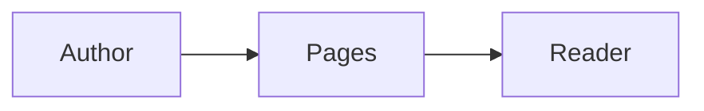

# Publish Pages

Publish technical reports through the bundled Python 3 standard-library helper, `scripts/pages.py`, relative to this skill directory. Use the helper's `--help` and command-specific `--help` for argument details.

**Report delivery:** Use Pages for standalone investigations, audits, benchmarks, and proposals. Return the verified URL and a short takeaway in chat. Keep ordinary replies in chat. Follow explicit destination requests; keep maintained documentation and implementation files in the repo. If Pages is unavailable or the audience is unsuitable, use chat if appropriate or a user-approved private destination, not a local Markdown report.

## 1. Establish access and audience

The helper authenticates as the owner of a **personal API key**. Have the user sign in to `/account` in their browser to create one for this agent; the account password is for browser login only. Revoking a key there disables that agent's API access without changing existing links.

The portable installer stores the URL and key in `~/.config/grds-pages/client.json` (or `$XDG_CONFIG_HOME/grds-pages/client.json`) with mode `0600`. Check access with `python3 scripts/pages.py list` without displaying the configuration. For manual setup, inject both `PAGES_URL` (the trusted API origin) and `PAGES_API_KEY` from a secret manager; they override the stored values. Use HTTPS outside trusted local networks. Returned public URLs may have a different origin.

For an interactive Bash session:

```bash
set +x
export PAGES_URL='https://pages.example.com'
read -r -s -p 'Pages API key: ' PAGES_API_KEY
printf '\n'
export PAGES_API_KEY
```

Keep the key in the private configuration or injected environment, not command arguments, Markdown, attachments, chat, or logs. Keep `client.json` mode `0600`. Treat `.env` as configuration data; source a shell file only when its contents are trusted. Avoid printing credentials or enabling shell tracing around secret loading. The helper redacts the configured key in its output, sends it only in the authorization header, and rejects redirects instead of forwarding credentials.

**Audience gate:** Every signed-in user can browse documents in `/library`. Anyone with a public page, Markdown source, or asset URL can read it without signing in. Groups organize pages; they do not restrict readers. Remove secrets and private data before publication. Sensitive artifacts require an appropriately restricted destination.

Proceed when `list` succeeds and the report is suitable for both audiences.

## 2. Author the report

Draft UTF-8 Markdown with a useful title, headings, evidence links, and explicit conclusions. Supply a separate `--description` of 1–500 characters after trimming: summarize what the reader will learn so they can decide whether to open the document in the library. Choose tables for comparisons and fenced code with a language label. Identify uncertainty rather than presenting inferred results as observations.

Mermaid uses a `mermaid` fence:

````markdown

````

Standard Markdown tables and inline HTML can be mixed:

```markdown
| Check | Result |
| --- | --- |
| Import | Passed |

<details><summary>Method</summary>

Describe the method and its limitations here.

</details>
```

HTML is sanitized by the server. Use semantic content such as `details`, `summary`, `figure`, `figcaption`, `img`, and `a`; rely on the site's theme rather than scripts, event handlers, styles, or embedded applications. Mermaid rendering depends on the public page's client-side renderer; keep a textual explanation for the diagram.

### Images and downloads

Pass every local file to `--asset`, and refer to its original basename through `asset:basename`:

```markdown


<figure>
  
  <figcaption>Measurements from the documented run.</figcaption>
</figure>

<a href="asset:measurements.csv" download>Download measurements</a>
```

References are replaced throughout the Markdown, including HTML attributes and code examples. Put references in link destinations or quoted attributes. Percent-encode whitespace or delimiter characters in a basename, for example `asset:run%20results.csv`; supply the actual local filename to `--asset`. All referenced basenames must have a matching `--asset`; duplicate basenames across supplied paths are rejected before any server write. Rename ambiguous files first. Unreferenced supplied attachments are still uploaded and displayed with the page.

Raster images can render inline. Other file types, including SVG and HTML, are forced downloads. After publishing, use an asset's returned `downloadUrl` (or append `?download=1` to its returned URL) when a forced download is needed for an otherwise inline image. Use the returned `url` for normal image embedding.

Proceed when every local reference has a unique readable attachment, and the report contains no credentials or unsuitable material.

## 3. Publish or update

Pipe Markdown to `/dev/stdin` on Linux instead of writing a report file in the workspace. If a file is needed, use a private temporary file outside the repo and remove it when done. Attachments still use file paths. The examples use the installed helper; in the repository use `skills/publish-pages/scripts/pages.py`.

```bash
python3 ~/.agents/skills/publish-pages/scripts/pages.py publish /dev/stdin \
  --title 'Latency investigation' \
  --description 'Why tail latency spiked and which timeout change reduced it.' \
  --asset ./charts/latency.png <<'MARKDOWN'
## Results


MARKDOWN
```

Success prints the actual public page URL returned by the server. Add `--json` to receive the full returned page, including its ID, Markdown, attachments, and URL. `create` is an alias for `publish`.

To replace an existing page, use the same command with `--page PAGE_UUID`. Supply the complete Markdown, title, and description. Existing attachments and the current group remain unless you specify a different group. Each `--asset` uploads a new attachment; to reuse an uploaded attachment, put its absolute URL in the Markdown and omit that file's `--asset`.

Publication is deliberately non-atomic: create the initial page, upload attachments, then update the final Markdown. A failed operation exits nonzero and reports the known page ID and recovery URL to stderr. It does not delete partial work or automatically retry writes. On an uncertain creation failure, use `list` to locate the page before creating another. On any partial failure, inspect `show` before retrying; an upload or final update may already have succeeded. Correct the issue and resume with `--page`, using already returned asset URLs to avoid duplicate uploads. Never report a failed or interrupted publication as successful.

## 4. Inspect and verify

```bash
python3 ~/.agents/skills/publish-pages/scripts/pages.py list
python3 ~/.agents/skills/publish-pages/scripts/pages.py show PAGE_UUID
python3 ~/.agents/skills/publish-pages/scripts/pages.py upload PAGE_UUID ./appendix.pdf
```

`list` returns your own page metadata; `show` returns the full page; `upload` returns the new asset's JSON without editing Markdown. Confirm the saved description, Markdown, and asset URLs with `show`. Open the returned public URL **without** the key and check the report and attachments as applicable. Public Markdown source is at `/p/PAGE_UUID/source.md`. Use returned asset URLs rather than constructing them.

For section links, resolve the rendered heading's `#` permalink (`a.section-link`) or table-of-contents link against the returned public URL. Open the link and verify it lands on the intended heading. Fragments such as `#doc-section-3` depend on heading order, not text. Reverify after reordering headings; share the page URL instead when the link must survive such edits.

Completion means the publish command succeeded, persisted content was inspected, and the public URL and relevant assets were verified. Return the public page URL and a brief account of what was actually checked. If public access or browser verification cannot be exercised, report that limit explicitly rather than claiming it passed.

## Organize documents

Run `groups` to find your group by name and use its returned ID. If a new group is wanted, `create-group 'NAME'` returns the new ID. Pass `--group GROUP_ID` to `publish` for initial assignment or when replacing content. To reorganize without republishing, run `set-group PAGE_UUID GROUP_ID` or `set-group PAGE_UUID --clear`; confirm `groupId` in the returned page. Only one group can hold a page at a time.

## Delete a page

When asked to remove a page, establish access as above and use `list` or `show` to identify the intended page UUID. Then run:

```bash
python3 ~/.agents/skills/publish-pages/scripts/pages.py delete PAGE_UUID
```

Deletion permanently removes the page, Markdown source, and all its attachments from the service; saved reader copies remain. Success prints the deleted UUID. A missing page exits nonzero with HTTP 404. After a timeout or network failure, use `show` to check whether deletion succeeded before retrying. Report deletion only after command success or verification that the page is missing.

## Portable installation

Run the provided single-file installer with Python 3 on the destination host; it installs the skill and private configuration without modifying shell startup files. The installer contains a personal API key: transfer it securely, keep it mode `0600`, and remove the copy after installation. Alternatively, copy the complete `publish-pages` directory into `~/.agents/skills/` and inject the URL and personal key. Start a new omp session to reload skill discovery. No Python packages are required.

For programmatic use, the server serves usage instructions at `/docs`, API details at `/docs/api.md`, and complete dependency-free clients at `/sdk/pages.py` (Python 3.8+) and `/sdk/pages.mjs` (Node.js 24). Download from the configured trusted server; their module documentation lists method signatures. These libraries accept explicit URL/key arguments and do not read the helper's private configuration.
