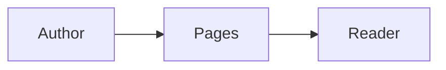

# Publish Pages

Publish technical reports through the bundled Python 3 standard-library helper, `scripts/pages.py`, relative to this skill directory. Use the helper's `--help` and command-specific `--help` for argument details.

## 1. Establish access and audience

The portable installer stores the server URL and bearer key in `~/.config/grds-pages/client.json` (or `$XDG_CONFIG_HOME/grds-pages/client.json`) with mode `0600`. The helper loads it automatically; check access with `scripts/pages.py list` without displaying the configuration. `PAGES_URL` and `PAGES_API_KEY` override the corresponding stored values when set. For manual configuration, supply both environment variables. The URL must be an absolute HTTP/HTTPS origin without credentials, query, or fragment; use HTTPS outside trusted local networks. The server's `PUBLIC_URL` determines returned public URLs and can differ from the agent's configured URL.

Prefer environment injection from a trusted secret manager. For an interactive Bash session, collect the key without echoing it or putting it in command history:

```bash
set +x
export PAGES_URL='https://pages.example.com'
read -r -s -p 'Pages API key: ' PAGES_API_KEY
printf '\n'
export PAGES_API_KEY
```

Keep the key in the private configuration or injected environment, not command arguments, Markdown, attachments, chat, or logs. Keep `client.json` mode `0600`. Treat `.env` as configuration data; source a shell file only when its contents are trusted. Avoid printing credentials or enabling shell tracing around secret loading. The helper redacts the configured key in its output, sends it only in the authorization header, and rejects redirects instead of forwarding credentials.

**Audience gate:** page HTML, Markdown source, and assets are publicly readable by anyone with their unguessable URLs. There is no per-reader login, and an unlisted link is not access control. Remove secrets and private data before publication. Sensitive artifacts require a network restriction around the service (for example, a private network or an access-controlled reverse proxy) before publishing.

Proceed when private configuration or environment credentials are available and the report is suitable for everyone who can reach its URL.

## 2. Author the report

Write a UTF-8 Markdown file with a useful title, concise summary, headings, evidence links, and explicit conclusions. Choose tables for comparisons and fenced code with a language label for technical examples. Identify uncertainty rather than presenting inferred results as observations.

Mermaid uses a `mermaid` fence:

````markdown

````

Standard Markdown tables and inline HTML can be mixed:

```markdown
| Check | Result |
| --- | --- |
| Import | Passed |

<details><summary>Method</summary>

Describe the method and its limitations here.

</details>
```

HTML is sanitized by the server. Use semantic content such as `details`, `summary`, `figure`, `figcaption`, `img`, and `a`; rely on the site's theme rather than scripts, event handlers, styles, or embedded applications. Mermaid rendering depends on the public page's client-side renderer; keep a textual explanation for the diagram.

### Images and downloads

Pass every local file to `--asset`, and refer to its original basename through `asset:basename`:

```markdown


<figure>
  
  <figcaption>Measurements from the documented run.</figcaption>
</figure>

<a href="asset:measurements.csv" download>Download measurements</a>
```

References are replaced throughout the Markdown, including HTML attributes and code examples. Put references in link destinations or quoted attributes. Percent-encode whitespace or delimiter characters in a basename, for example `asset:run%20results.csv`; supply the actual local filename to `--asset`. All referenced basenames must have a matching `--asset`; duplicate basenames across supplied paths are rejected before any server write. Rename ambiguous files first. Unreferenced supplied attachments are still uploaded and displayed with the page.

Raster images can render inline. Other file types, including SVG and HTML, are forced downloads. After publishing, use an asset's returned `downloadUrl` (or append `?download=1` to its returned URL) when a forced download is needed for an otherwise inline image. Use the returned `url` for normal image embedding.

Proceed when every local reference has a unique readable attachment, and the report contains no credentials or unsuitable material.

## 3. Publish or update

These commands use the portable installed location; when working from the repository, substitute `skills/publish-pages/scripts/pages.py`.

```bash
python3 ~/.agents/skills/publish-pages/scripts/pages.py publish report.md \
  --title 'Latency investigation' \
  --description 'Results, evidence, and operational recommendation' \
  --asset ./charts/latency.png \
  --asset ./data/measurements.csv
```

Success prints the actual public page URL returned by the server. Add `--json` to receive the full returned page, including its ID, Markdown, attachments, and URL. `create` is an alias for `publish`.

To replace an existing page, use the same command with `--page PAGE_UUID`. Supply the complete Markdown, title, and description: this is a full replacement, and omitting the description clears it. Existing attachments remain. Each `--asset` uploads a new attachment; when reusing an already uploaded attachment, use its absolute URL in the Markdown and omit that file's `--asset`.

Publication is deliberately non-atomic: create the initial page, upload attachments, then update the final Markdown. A failed operation exits nonzero and reports the known page ID and recovery URL to stderr. It does not delete partial work or automatically retry writes. On an uncertain creation failure, use `list` to locate the page before creating another. On any partial failure, inspect `show` before retrying; an upload or final update may already have succeeded. Correct the issue and resume with `--page`, using already returned asset URLs to avoid duplicate uploads. Never report a failed or interrupted publication as successful.

## 4. Inspect and verify

```bash
python3 ~/.agents/skills/publish-pages/scripts/pages.py list
python3 ~/.agents/skills/publish-pages/scripts/pages.py show PAGE_UUID
python3 ~/.agents/skills/publish-pages/scripts/pages.py upload PAGE_UUID ./appendix.pdf
```

`list` returns authenticated page metadata; `show` returns the full page; `upload` returns the new asset's JSON without editing Markdown. Use `show` to confirm persisted content and asset URLs. Then fetch the returned public page URL **without** the API key, open it in a browser, and check the report's headings, table, code, Mermaid diagram, image, and download as applicable. The public Markdown source is at `/p/PAGE_UUID/source.md` on the public server. Use returned asset URLs rather than constructing them.

Completion means the publish command succeeded, persisted content was inspected, and the public URL and relevant assets were verified. Return the public page URL and a brief account of what was actually checked. If public access or browser verification cannot be exercised, report that limit explicitly rather than claiming it passed.

## Delete a page

When asked to remove a page, establish access as above and use `list` or `show` to identify the intended page UUID. Then run:

```bash
python3 ~/.agents/skills/publish-pages/scripts/pages.py delete PAGE_UUID
```

Deletion permanently removes the page, Markdown source, and all its attachments from the service; saved reader copies remain. Success prints the deleted UUID. A missing page exits nonzero with HTTP 404. After a timeout or network failure, use `show` to check whether deletion succeeded before retrying. Report deletion only after command success or verification that the page is missing.

## Portable installation

Run the provided single-file installer with Python 3 on each host; it installs this skill and its private configuration without modifying shell startup files. The installer contains the publishing key: transfer it securely, keep it mode `0600`, and remove the copied installer after use. Alternatively, copy this complete `publish-pages` directory, including `scripts/`, into `~/.agents/skills/` and configure credentials manually. Start a new omp session to reload skill discovery. No Python packages are required.
